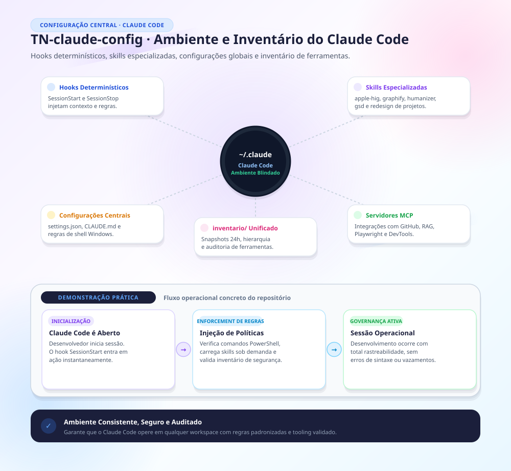

# TN-claude-config

Configuração canônica, hooks de ciclo de vida, catálogo de skills e inventário unificado do ambiente **Claude Code** em estação de trabalho de desenvolvimento.

---

## 1. Visão Geral da Estrutura

```
TN-claude-config/
├── hooks/                 # Hooks de ciclo de vida (SessionStart, PreToolUse, PostToolUse, Stop)
├── skills/                # Catálogo de skills modulares do Claude Code
├── ORIGEM.md              # Rastreamento de versão de sincronização
└── inventario/            # Inventário unificado do ecossistema de desenvolvimento
    ├── HIERARQUIA.md      # Arquitetura e camadas de agentes
    ├── INVENTARIO-24H.md  # Relatório consolidado do ambiente
    ├── ROTEAMENTO.md      # Apontamento para o ecossistema claude-tokenrouter
    ├── config/            # Listas de plugins, skills ativas, MCPs e settings sanitizados
    ├── llm/               # Modelos locais instalados no Ollama e configuração do OpenCode
    └── tooling/           # Ferramentas instaladas via npm global, uv e winget
```

---

## 2. Inventário do Ambiente (`inventario/`)

A seção `inventario/` consolida o estado completo do ambiente operacional:
- **`inventario/config/`**: Configurações de servidores MCP sanitizadas, lista de marketplaces conhecidos e plugins ativos.
- **`inventario/llm/`**: Modelos carregados no Ollama local (ex.: `gpt-oss:20b`, `Qwen3-Coder-Next :NOTPL 36 GB`, `nemotron-3.5-lightning:30b-a3b`).
- **`inventario/tooling/`**: Relação de pacotes globais do Node.js/npm, ferramentas Python gerenciadas via `uv` e softwares do sistema via `winget`.

---

## 3. Roteamento de Modelos e Token Router

O gerenciamento de modelos em escada e contingência com executores locais Ollama é operado pelo projeto dedicado:
- Repositório público: [TN-claude-tokenrouter](https://github.com/thalesnola/TN-claude-tokenrouter)
